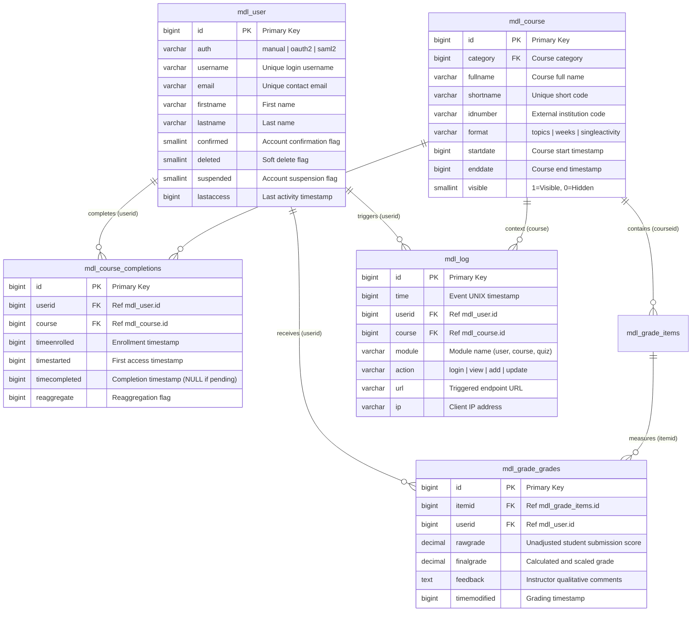

# Week 5 Day 2: Moodle Core Database Schema & ER Analysis

## 1. Five Core Tables Overview

In enterprise Moodle LMS, the core pedagogical and operational lifecycle is anchored by five relational tables:

1. **`mdl_course` (`m_course`)**: Stores instructional units, course metadata, visibility, curriculum format (`topics`, `weeks`), and lifecycle timestamps (`startdate`, `enddate`).
2. **`mdl_user` (`m_user`)**: Central identity store recording credentials, authentication method (`auth`), personal details, and account status flags (`confirmed`, `deleted`, `suspended`).
3. **`mdl_course_completions` (`m_course_completions`)**: Tracks individual learner progress, enrollment timestamps, course start times, and final completion milestones.
4. **`mdl_grade_grades` (`m_grade_grades`)**: Holds assessment outcomes, linking users (`userid`) to grade items (`itemid`), storing raw marks, weighted final grades, and marker feedback.
5. **`mdl_log` / `mdl_logstore_standard_log` (`m_log`)**: Immutable audit trail capturing every user activity, HTTP request, CRUD event, context, timestamp, and IP address.

---

## 2. Plain English Summary (Max 200 Words)

> Moodle organizes digital education around five core database tables. **`mdl_course`** defines individual courses, while **`mdl_user`** stores student and instructor identities. When learners engage with instructional material, **`mdl_course_completions`** connects `mdl_user` and `mdl_course` to track whether students have begun or finished their curriculum requirements. As students complete assignments and quizzes, their marks and feedback are recorded in **`mdl_grade_grades`**, which links learner IDs to course assessment items. Finally, every interaction—from authentication to page views—is continuously audited in **`mdl_log`** (and `mdl_logstore_standard_log`), tying user actions to specific course contexts with precise timestamps and IP addresses. Together, these five tables establish a cohesive relational backbone linking identity, curriculum, academic achievement, completion milestones, and regulatory compliance.

---

## 3. Entity-Relationship (ER) Diagram

