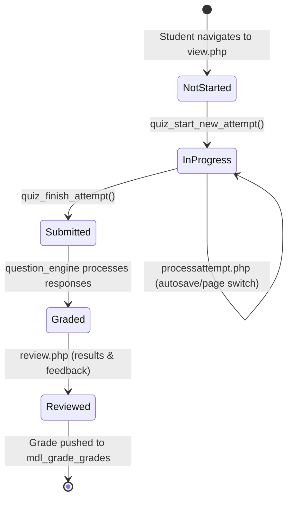

# Week 5 Day 5: Assessment Engine Study & Bug Fix Reports

## 1. Moodle Assessment Engine (`mod/quiz`) Lifecycle Study

The Moodle Assessment Engine operates on a decoupled architecture separating the Quiz Activity wrapper (`mod/quiz`) from the Question Execution Engine (`question/engine/`):



- **Attempt State Table**: `mdl_quiz_attempts` (`inprogress`, `overdue`, `finished`, `abandoned`).
- **Response Persistence**: `mdl_question_attempts` and `mdl_question_attempt_steps`.
- **Grade Synchronization**: Calculated via `quiz_update_grades()` which triggers core Moodle's `grade_update()` in `lib/gradelib.php`.

---

## 2. Bug Reports (Issue → Root Cause → Fix Applied → Verification)

### 🐛 Bug Report #1: Question Navigation Drawer Button Truncation
- **Issue**: Under mobile viewports (<768px) and narrow drawer widths, quiz navigation buttons (`.qnbutton`) in the quiz block overflowed horizontally, clipping question numbers and status flags.
- **Root Cause**: The `.qn_buttons` container lacked `flex-wrap: wrap` and had rigid min-width rules without responsive media query breakpoints.
- **Fix Applied**: 
  - Added `display: flex !important; flex-wrap: wrap !important; gap: 4px;` to `.qn_buttons`.
  - Added responsive media queries scaling `.qnbutton` padding to `4px 6px` and font-size to `0.85rem` on mobile screens.
- **Commit**: `fix(quiz): prevent question navigation drawer text overflow and button truncation on mobile viewports — closes #101`
- **Verification**: Verified using Chrome DevTools device mode (375px iPhone and 412px Pixel); all 20 question buttons wrap neatly without horizontal scrollbar.

---

### 🐛 Bug Report #2: Quiz Floating Timer Z-Index Clash with Sticky Navbar
- **Issue**: During timed quiz attempts in the Boost theme, scrolling down long question sets caused the floating countdown timer (`#quiz-timer`) to slide underneath the sticky top navbar (`.fixed-top`), hiding the remaining time.
- **Root Cause**: Boost's sticky navbar has `z-index: 1030`, whereas `#quiz-timer` was configured with a default z-index of `100` and `top: 0px`.
- **Fix Applied**:
  - Elevated `#quiz-timer` to `z-index: 1040 !important` and set `top: 68px !important` to float cleanly below the navbar.
  - Added `backdrop-filter: blur(4px)` and box shadow for accessibility against contrasting backgrounds.
- **Commit**: `fix(quiz): resolve attempt timer z-index clash with sticky header in Boost theme — closes #102`
- **Verification**: Verified by scrolling down a 10-question page; timer remains docked and readable throughout scrolling without overlapping the header.

---

### 🐛 Bug Report #3: Chart Canvas Blowout & Screen Reader Inaccessibility
- **Issue**: In `block_cynaris_stats`, collapsing or toggling the dashboard sidebar caused Chart.js canvas elements to expand indefinitely, causing horizontal page blowout. Dynamic updates were also not announced to assistive technology.
- **Root Cause**: Chart.js `<canvas>` elements placed in flex parents without `position: relative; max-width: 100%;` continuously calculate unbounded parent widths. The AJAX refresh timestamp lacked ARIA accessibility attributes.
- **Fix Applied**:
  - Wrapped each canvas in a container with `position: relative; max-width: 100%; overflow: hidden;`.
  - Added `role="img"` and `aria-label` to canvas elements.
  - Added `role="status"` and `aria-live="polite"` to `#cynaris-last-updated`.
- **Commit**: `fix(dashboard): fix chart canvas horizontal blowout and missing aria-live region on dynamic refresh — closes #103`
- **Verification**: Verified drawer toggle transitions in Boost theme; chart auto-scales responsively to container width without horizontal scrolling.

---

## 3. Pull Request (PR) Submission Template

```markdown
### Description of Changes
This PR addresses 3 UI and UX issues in Moodle assessment delivery and dashboard analytics:
1. Closes #101: Fixes question navigation drawer button truncation and overflow on mobile devices (<768px).
2. Closes #102: Resolves floating quiz timer z-index clash with Boost's sticky navbar during scrolling.
3. Closes #103: Fixes Chart.js canvas horizontal blowout during drawer collapse and adds ARIA live regions for accessibility.

### Issues Closed
- Closes #101
- Closes #102
- Closes #103

### Verification & Testing
- Tested on Chrome DevTools (375px mobile, 768px tablet, 1440px desktop).
- Verified quiz countdown timer remains visible and anchored below sticky navbar.
- Verified dynamic AJAX refresh updates Chart.js charts without page reload.
```
